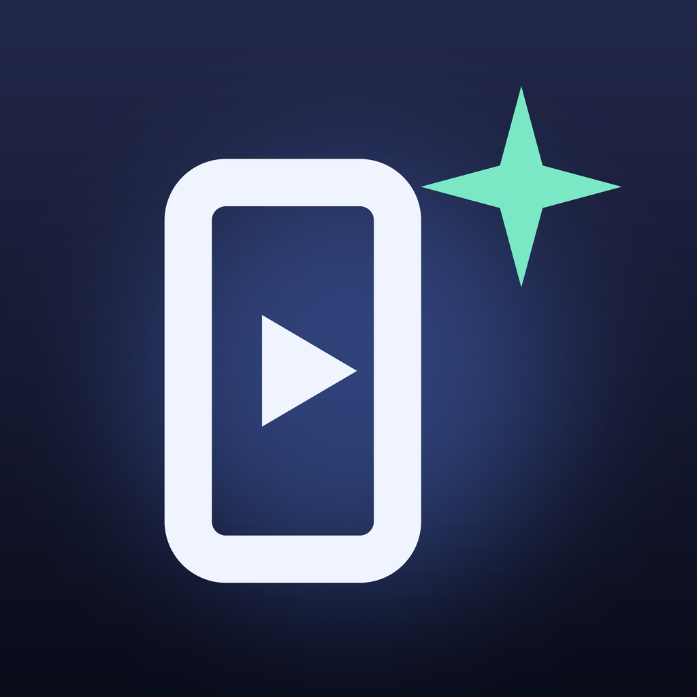

<p align="center"></p>

<h1 align="center">Promo Studio</h1>

<p align="center">Geliştirdiğin uygulamalar için tanıtım videoları, <b>Claude Code'un yazıp yönettiği</b>.</p>

<p align="center">
  <a href="https://github.com/ardasnturk/promo-studio/releases/latest"></a>
  <a href="https://github.com/ardasnturk/promo-studio/actions/workflows/ci.yml"></a>
  
  <a href="LICENSE"></a>
</p>

<p align="center"><a href="README.md">English</a> · <b>Türkçe</b></p>

> **Promo Studio; Claude Code, Remotion, Gemini ve Instagram ile çalışır.**
> Bağımsız, açık kaynak bir projedir; **Anthropic, Remotion, Google ya da Meta
> ile bağlantılı değildir, onlar tarafından onaylanmamış ya da desteklenmemiştir.**
> Bu hizmetleri koşullarına uygun kullanmak senin sorumluluğundadır.

Promo Studio, uygulamanın kaynak kodundan kısa dikey videolar (Reels, TikTok,
Shorts) üreten bir Mac uygulamasıdır. Projeni okur, isteğinden — gerekirse
web'de araştırarak — bir storyboard yazar, Claude'a buna özel bir
[Remotion](https://www.remotion.dev) videosu kodlatır, seslendirmeyle render
eder ve Instagram'da paylaşır ya da zamanlar.

Promo Studio **kendi `claude` CLI'ını**, kendi hesabınla çalıştırır. Promo
Studio'nun sunucusu, hesabı ya da telemetrisi yoktur: kodun, anahtarların ve
videoların Mac'inde kalır.

## Özellikler

* **Claude'un yönettiği promosyon filmleri** — isteğinden sahne sahne bir
  storyboard, senin onayınla kinetik yazı, sayaçlar, telefon çekimleri ve ses
  efektleriyle kendine özel kodlanan bir Remotion videosu; düz cümlelerle
  revize edersin.
* **Hızlı şablonlar** — bütün bir filme gerek olmadığında uygulamanın
  özelliklerinden ve ekran görüntülerinden tek tıkla video.
* **Kaynaklı araştırma** — Claude güncel bilgileri (tarih, kadro, fiyat)
  ekrana koymadan önce web'de doğrular ve kaynaklarını gösterir.
* **Seslendirme ve müzik** — sahnelere oturtulan Gemini seslendirmesi
  (isteğe bağlı) ve telifsiz bir arka plan ritmi.
* **Instagram** — resmi API'lerle Reels'i hemen paylaş ya da zamanla, sonra
  izlenme ve erişimi izle. İsteğe bağlı: **Videoyu kaydet…** MP4'ü dışa aktarır.
* **On dil** — videolar ve uygulamanın kendisi English, Türkçe, Deutsch,
  Español, Français, Italiano, Português, 日本語, 한국어 ve 简体中文 dillerinde.
* **Menü çubuğu öncelikli** — seni bekleyenler, üretimdeki işler ve sıradaki
  paylaşımlarla bir panel; stüdyo penceresi kapalıyken de zamanlanmış
  paylaşımlar gider.
* **iPhone'dan** — [Remote Code](https://github.com/ardasnturk/remote-code) ile
  videoları telefondan oluştur, onayla ve paylaş.

## İçindekiler

* [Hızlı başlangıç](#hızlı-başlangıç)
* [Gereksinimler](#gereksinimler)
* [Kurulum](#kurulum)
* [Promosyon filmi yapmak](#promosyon-filmi-yapmak)
* [Hızlı şablonlar](#hızlı-şablonlar)
* [Instagram](#instagram)
* [Seslendirme, müzik ve diller](#seslendirme-müzik-ve-diller)
* [Promo Templates](#promo-templates)
* [Menü çubuğu](#menü-çubuğu)
* [iPhone'dan uzaktan yönetim](#iphonedan-uzaktan-yönetim)
* [Güncellemeler](#güncellemeler)
* [Sorun giderme](#sorun-giderme)
* [Gizlilik ve güvenlik](#gizlilik-ve-güvenlik)
* [SSS](#sss)
* [Kaynaktan derleme](#kaynaktan-derleme)
* [Katkıda bulunmak](#katkıda-bulunmak)
* [Lisans](#lisans)

## Hızlı başlangıç

1. **Promo Studio'yu kur** — DMG'yi
   [Releases](https://github.com/ardasnturk/promo-studio/releases/latest)
   sayfasından indir, Promo Studio'yu Uygulamalar'a sürükle ve aç. Simgesi menü
   çubuğunda belirir ve stüdyo penceresi açılır.
2. **Kurulum kontrol listesini tamamla** — bir şey eksikse kendiliğinden açılır:
   Claude Code (kurulu ve oturum açık) ve Node.js 20+. Remotion'ın yanındaki
   **Kur**'a bas; ilk seferde birkaç dakika sürer.
3. **Uygulamanı ekle** — kenar çubuğunda **Proje klasörü ekle…** ile
   uygulamanın kaynak klasörünü seç. Claude onu analiz eder: özellikler, hedef
   kitle, marka renkleri ve ekran görüntüleri.
4. **İsteğini yaz** — projede **Prompt yaz…**: "yeni widget'lar için 20
   saniyelik bir lansman filmi". Claude storyboard'u yazar; onaylarsın, video
   kodlanır ve render edilir.
5. **Paylaş** — **Videoyu kaydet…** ya da **Paylaş**; veya Instagram'ı bir kez
   bağla ve stüdyodan paylaş ya da zamanla.

Seslendirme ve Instagram isteğe bağlıdır; Gemini anahtarı ve Meta uygulaması
için [docs/SETUP.tr.md](docs/SETUP.tr.md).

## Gereksinimler

| | |
|---|---|
| Mac | macOS 15 Sequoia veya üstü, Apple silicon ya da Intel |
| Claude Code | Resmi CLI kurulu ve **kendi Claude hesabınla** oturum açılmış (`claude auth status`) |
| Node.js | 20 veya üstü; Promo Studio Remotion'ı kurar ve onunla gelen ffmpeg'i kullanır |
| Seslendirme | İsteğe bağlı. Bir [Gemini API anahtarı](https://aistudio.google.com) (ücretsiz katman: model başına günde yaklaşık 10 istek, video başına bir) |
| Instagram | İsteğe bağlı. İşletme ya da İçerik üreticisi hesabı ve kendi Meta geliştirici uygulaman |
| Yerel ekranlar | İsteğe bağlı. iOS Simülatörü ile Xcode |

## Kurulum

Notarize edilmiş `PromoStudio-<sürüm>.dmg` dosyasını
[GitHub Releases](https://github.com/ardasnturk/promo-studio/releases)
sayfasından indir ya da Homebrew kullan:

```sh
brew tap ardasnturk/promo-studio https://github.com/ardasnturk/promo-studio
brew install --cask promo-studio
```

Promo Studio'yu aç. İlk açılışta **kurulum kontrol listesi** neyin eksik
olduğunu bağlantı ve komutlarla gösterir (**Yardım → Kurulum kontrol
listesi…** yeniden açar). Meta uygulaması ve Gemini anahtarı dahil adım adım
anlatım: **[docs/SETUP.tr.md](docs/SETUP.tr.md)**.

## Promosyon filmi yapmak

Projede **Prompt yaz…** (ya da **Özelleştir… → Kendi isteğim**):

1. **Storyboard** — Claude isteğini bir yönetmen storyboard'una çevirir:
   konsept ve görsel dil, her sahne için görsel ve hareket notu, ekran metni,
   seslendirme, ses efektleri ve hangi ekran görüntülerinin kullanılacağı.
   **Claude web'de araştırsın** açıkken önce güncel bilgileri kontrol eder ve
   kaynaklarını listeler. Storyboard'u elle düzeltebilir ya da **Claude ile
   revize** sekmesinden değişiklik isteyebilirsin.
2. **Onayla ve üret** — seslendirme üretilir (sahne süreleri sese göre
   ayarlanır), Claude videoyu Remotion'da kodlar, işini `tsc` ve render
   edilen karelerle kendisi kontrol eder, Promo Studio da render eder.
   **Seslendirmesiz** seslendirmeyi atlar.
3. **Revize et** — "kancadaki başlık kenara taşıyor, ortala". Claude
   storyboard'u ve yalnızca değişmesi gereken kodu günceller, video yeniden
   render edilir. Önceki her sürüm saklanır; **Bu sürüme dön** geri getirir.

Claude `RemotionTemplate/src/kit` içindeki hareket kitiyle çalışır
([KIT.md](RemotionTemplate/KIT.md)); yalnızca o videonun klasörüne yazabilir
(`Edit(src/videos/<id>/**)`) ve yalnızca `npx tsc` ile `npx remotion still`
çalıştırabilir. Bir şablon kütüphanesinde projenin adını taşıyan bir klasör
varsa (ör. `src/Acme`), Claude onu marka kiti olarak okur.

## Hızlı şablonlar

Analiz edilen her proje özelliklerini ve içerik fikirlerini listeler. **Hızlı
video** bir özellikten tek tıkla 15 saniyelik video yapar; **Özelleştir…** ile
tema, süre, dil ve notları seçersin. Bu modda Claude hazır bir şablon için
senaryo yazar (kanca, özellikler, sayılar, harekete geçirici mesaj), Promo
Studio da ekran görüntülerin ve marka renklerinle render eder.

## Instagram

Promo Studio resmi Instagram API'lerini kullanır; parola saklanmaz, token'lar
Keychain'de durur. Bağlamak isteğe bağlıdır.

* **Facebook girişi** (varsayılan) yönettiğin Facebook sayfalarına bağlı tüm
  Instagram hesaplarını tek seferde ekler. **Instagram girişi** sayfa olmadan
  çalışır.
* İkisi de kendi Meta geliştirici uygulamanı gerektirir; kendi hesapların için
  geliştirme modunda kalabilir. İzinler ve ayarlar:
  [docs/SETUP.tr.md](docs/SETUP.tr.md#instagram).
* Her proje kendi hesabıyla paylaşır (proje başlığındaki seçici). Videolar
  doğrudan yüklenir; herkese açık bir sunucu gerekmez.
* App Secret girildiyse token'lar 60 güne uzatılır ve süresi dolmadan yenilenir.

## Seslendirme, müzik ve diller

* Claude her sahne için tek seslendirme satırı yazar (`[excited]` gibi bir ton
  etiketiyle); tüm satırlar tek Gemini TTS isteğiyle seslendirilir, duraklardan
  bölünür ve sahnelere oturtulur. Günlük Gemini kotası dolunca Promo Studio ne
  zaman yenileneceğini söyler; seslendirmesiz üretebilirsin.
* Arka plan, yerelde üretilen telifsiz 120 BPM bir ritimdir ve sesin altında
  kısılır.
* Her video kendi dilinde üretilir; **Başka dilde kopyala** metinleri,
  seslendirmeyi, açıklamayı ve hashtag'leri uyarlayıp yeniden render eder.
* Uygulama Mac'inin dilini izler (Remote Code ile aynı on dil). Başka bir dil
  için Sistem Ayarları → Genel → Dil ve Bölge → Uygulamalar.
* **Yerel ekranlar…** uygulamanı her dilde iOS Simülatörü'nde açar ve
  Claude'un kodunda bulduğu ekranları yakalar (UI testleri, başlatma
  argümanları, deep link'ler).

## Promo Templates

[Promo Templates](https://github.com/ardasnturk/promo-templates), Promo
Studio'nun şablon kütüphanesidir: hazır kalıplar (fizik döngüleri, gerçek bir
çözücüyle çözülen bulmacalar, metinsiz makineler, rahatlatıcı egzersizler,
mesajlaşma hikâyeleri) ve her türden yeni video üreten Claude Code skill'leri.
Promo Studio kurmayı önerir ve güncel tutar; Claude Code skill'leri olan her
Remotion projesi **Kütüphane ekle…** ile eklenebilir.

* **Üret…** — bir skill seç ve isteğini yaz; Claude onu kütüphanede çalıştırır,
  videoyu yazar, kontrol eder ve render eder; Promo Studio açıklamasıyla içe
  aktarır.
* **Trendleri araştır** — fikir skill'i trendleri araştırır ve konsept önerir; **Bunu
  üret** ilgili skill'i başlatır.
* **Bu parametrelerle yeniden render et** — şablon videonun parametrelerini
  değiştir ve Claude olmadan render et.

## Menü çubuğu

Promo Studio menü çubuğunda yaşar. Paneli seni bekleyenleri (onay bekleyen
storyboard'lar, başarısız paylaşımlar, kurulum), üretimdekileri ilerlemesiyle,
sıradaki paylaşımları ve yeni bir promosyon filmi başlatma kutusunu gösterir.
Dock simgesi yalnızca stüdyo ya da Ayarlar penceresi açıkken görünür.
**Ayarlar → Genel → Girişte aç** onu Mac'inle başlatır; zamanlanmış
paylaşımlar vaktinde gider.

## iPhone'dan uzaktan yönetim

Aynı Mac'te [Remote Code](https://github.com/ardasnturk/remote-code) varsa
iPhone ve iPad uygulamasında bir **Promo Studio** sekmesi çıkar: projeler,
istekten video, storyboard ve revizyonlar, video oynatma, açıklamalar,
paylaşma, zamanlama ve Instagram girişi — Remote Code'un uçtan uca şifreli
bağlantısı üzerinden. Remote Code ayrıca video hazır olduğunda, storyboard onay
beklediğinde, paylaşım yapıldığında ya da bir iş başarısız olduğunda Mac'te ve
telefonda bildirim gönderir; üretimdeki işler kalan süreyi gösterir. Promo Studio yalnızca `127.0.0.1` üzerinde token korumalı
bir API sunar; bkz. [docs/CONTROL_API.md](docs/CONTROL_API.md).

## Güncellemeler

Promo Studio günde bir kez GitHub'da yeni sürüm arar (Ayarlar → Güncellemeler).
**Kur ve yeniden başlat** indirir; SHA-256 sağlamasını, Apple notarizasyonunu
ve geliştirici imzasını denetler, uygulamayı değiştirir ve yeni sürümü açar.
GitHub'dan gelen şablon kütüphaneleri de denetlenir ve yerel değişiklik yoksa
git ile güncellenir. Homebrew kullananlar `brew upgrade --cask promo-studio`
da çalıştırabilir.

## Sorun giderme

**Claude Code ya da Node.js kurulu ama "bulunamadı" görünüyor.** Finder'dan
açılan uygulamalar Terminal'in `PATH`'ini almaz. Promo Studio bunu login
shell'den okur; ayrıca `/opt/homebrew/bin`, `/usr/local/bin` ve `~/.local/bin`
klasörlerine bakar. Sürüm yöneticisiyle kurulan araçları `~/.zprofile`'da da
tanımla ve kontrol listesinde **Yeniden denetle**'ye bas.

**macOS Keychain erişimi soruyor.** Bir kez **Her zaman izin ver**'i seç.
Yayın sürümleri bu izni güncellemelerde korur.

**"Gemini kotası doldu".** Ücretsiz katman model başına günde yaklaşık 10
seslendirme isteğine izin verir. **Seslendirmesiz** üret, Ayarlar'dan başka bir
TTS modeli seç ya da Promo Studio'nun gösterdiği yenilenme saatini bekle.

**Girişten sonra Instagram hesabı yok.** Promo Studio neyin eksik olduğunu
söyler: bir izin, girişte seçilmeyen bir sayfa ya da hesap, veya sayfaya bağlı
İşletme/İçerik üreticisi hesabı olmayan bir hesap. Bkz.
[docs/SETUP.tr.md](docs/SETUP.tr.md#sorun-çıkarsa).

## Gizlilik ve güvenlik

* **Sunucu yok, telemetri yok.** Promo Studio yalnızca `claude` CLI'ınla (ve
  onun üzerinden Anthropic'le), anahtar eklediysen Google'ın Gemini API'siyle,
  Instagram için Meta'nın Graph API'siyle, güncellemeler için GitHub'la ve
  Claude'un araştırmada okuduğu web sayfalarıyla konuşur.
* **Sırlar** — Instagram token'ları, Meta App Secret ve Gemini anahtarı
  Keychain'de tutulur; dosyalara ya da istemlere asla yazılmaz.
* **Claude'a dar araçlar** — analiz ve yazım salt okunurdur; video kodlama
  yalnızca o videonun klasörüne yazabilir.
* **Yerel API** — uzaktan yönetim API'si yalnızca `127.0.0.1`'i dinler ve 0600
  izinli dosyada saklanan rastgele bir token ister.
* **Veri** — `~/Library/Application Support/Promo Studio` (projeler,
  gönderiler, render'lar). Başka bir şey yok, başka bir yerde yok.

Güvenlik açıklarını lütfen *Security → Report a vulnerability* üzerinden gizli
bildir ([SECURITY.md](SECURITY.md)).

## SSS

**Promo Studio için Claude aboneliği gerekir mi?**
Claude Code CLI'ın neye ihtiyaç duyuyorsa: Claude Code erişimi olan bir Claude
hesabı ya da bir Anthropic API anahtarı. Video kodlama, hızlı şablona göre
belirgin biçimde daha çok kullanım harcar. Promo Studio'nun kendisi ücretsizdir.

**Remotion ücretsiz mi?**
Remotion'ın kendi lisansı vardır: bireyler, kâr amacı gütmeyen kuruluşlar ve en
fazla 3 çalışanlı şirketler için ücretsizdir; daha büyük şirketlerin
[şirket lisansı](https://www.remotion.dev/license) alması gerekir.

**Kodum Mac'imden çıkar mı?**
Yalnızca Claude Code'la zaten çıktığı kadar: CLI her zamanki gibi Anthropic'le
konuşur. Render Mac'inde yapılır.

**Instagram dışında bir yerde paylaşabilir miyim?**
**Videoyu kaydet…** ya da **Paylaş** ile MP4'ü al ve istediğin yerde paylaş;
doğrudan paylaşım şimdilik yalnızca Instagram'da.

**Zamanlanmış paylaşım gitmedi.**
Paylaşımı uygulama yapar; çalışıyor olması gerekir (menü çubuğu yeterli). Mac
uyuyorsa paylaşım uyandığında gider.

**Nasıl kaldırırım?**
Promo Studio'dan çık ve sil (ya da `brew uninstall --zap --cask
promo-studio`). Tertemiz bir başlangıç için
`~/Library/Application Support/Promo Studio` klasörünü ve Keychain Erişimi'ndeki
"Promo Studio" öğesini sil.

## Kaynaktan derleme

```sh
git clone https://github.com/ardasnturk/promo-studio.git && cd promo-studio
brew install xcodegen && xcodegen generate
open PromoStudio.xcodeproj          # Xcode 16 veya üstü; PromoStudio şeması
```

* `PromoStudio/` — uygulama: `App` (durum, işler, zamanlayıcı), `Services`
  (Claude Code, Remotion, Instagram, Gemini, kontrol API'si), `Views`.
* `RemotionTemplate/` — Claude'un kodladığı video şablonu ve hareket kiti.
* `CaptureRunner/` — yerel ekranlar için XCUITest çalıştırıcısı.
* Derlemeler ad-hoc imzalanır; Keychain iznini yeniden derlemelerde korumak
  için `Config/Signing.local.xcconfig` ile kendi ekibinle imzala.
* Sürümler: [docs/RELEASE.md](docs/RELEASE.md). Değişiklikler:
  [CHANGELOG.md](CHANGELOG.md). Çeviriler: `l10n/` ve
  `python3 scripts/l10n.py --check`.

Üçüncü taraf Swift bağımlılığı yoktur.

## Katkıda bulunmak

Issue ve pull request'ler memnuniyetle karşılanır — lütfen önce
[CONTRIBUTING.md](CONTRIBUTING.md) ve [davranış kurallarını](CODE_OF_CONDUCT.md)
oku. Yeni hareket kiti bileşenleri ve şablon skill'leri iyi ilk katkılardır.
Güvenlik sorunları için: [SECURITY.md](SECURITY.md).

## Lisans

[MIT](LICENSE) © 2026 Arda Şentürk. Promo Studio, kendi
[lisansı](https://www.remotion.dev/license) olan
[Remotion](https://www.remotion.dev) ile render eder.

"Claude" ve "Claude Code" Anthropic, PBC'nin; "Instagram" ve "Facebook" Meta
Platforms, Inc.'in; "Gemini" Google LLC'nin; "Remotion" Remotion AG'nin
ticari markalarıdır. Burada yalnızca uyumluluğu anlatmak için kullanılırlar.
